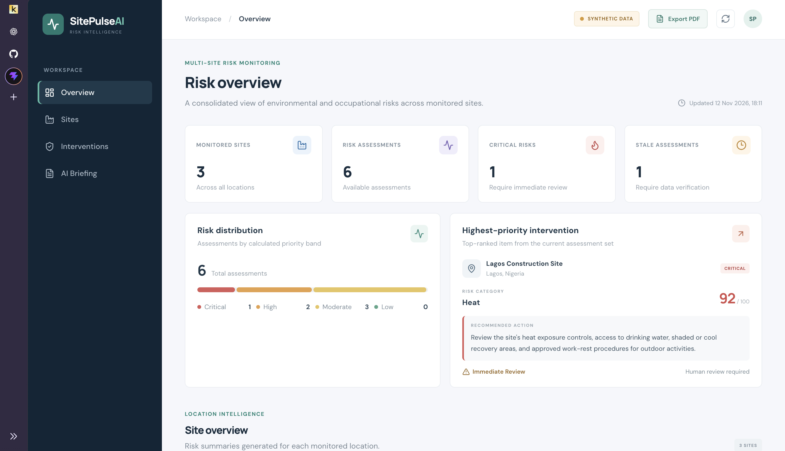
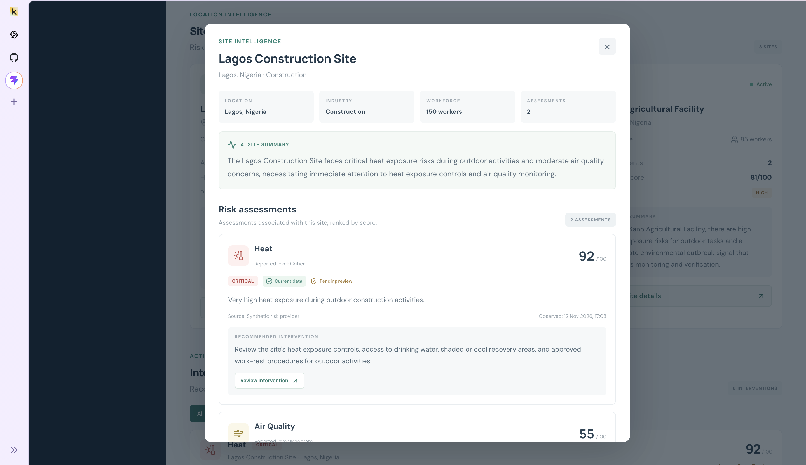
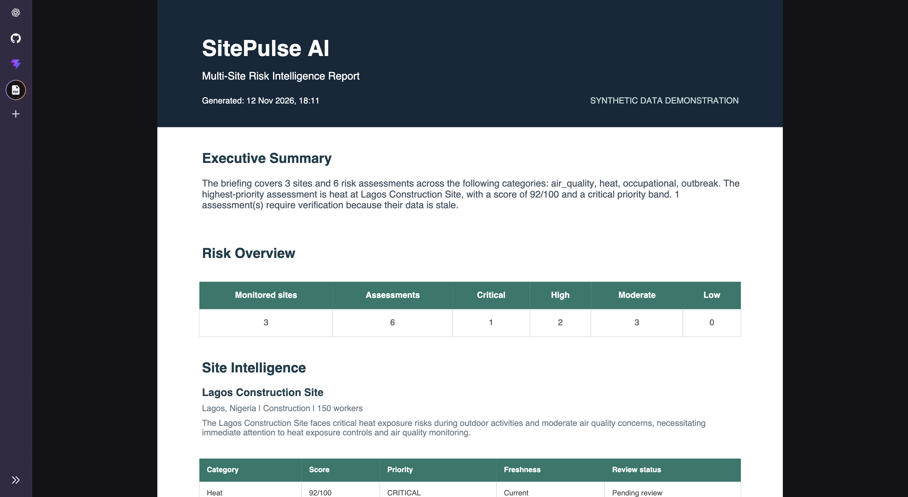

# SitePulse AI

**An independent exploration of AI-assisted operational risk prioritisation and supervisor workflows.**

SitePulse AI is an independent prototype that explores how existing climate and occupational risk intelligence can support multi-site operational decision-making.

The prototype combines deterministic Python-based prioritisation, constrained LLM-generated briefings and a human review workflow. It explores a possible extension to existing workforce risk intelligence platforms through clearer cross-site intervention queues, evidence-grounded explanations and supervisor follow-up.

The project uses synthetic demonstration data.

## Why I built it

Workforce risk intelligence platforms already provide important capabilities such as climate-risk monitoring, occupational safety guidance and site-level reporting.

I wanted to explore an additional engineering question:

**How could risk information from multiple locations be organised into a clear, evidence-backed workflow that helps supervisors understand priorities, review recommended interventions and record follow-up decisions?**

SitePulse AI is a practical exploration of that question.

### Risk Overview Dashboard



### Site Intelligence and Supervisor Review



### Exported Risk Intelligence Report



## What the prototype demonstrates

### 1. Multi-site risk overview

A consolidated dashboard showing risk assessments across multiple demonstration sites, including their reported risk levels, scores and categories.

### 2. Deterministic prioritisation

Python rules organise assessments by calculated priority band and score. Assessment age and data freshness are also considered.

The LLM does not calculate risk scores, assign priority bands or determine intervention urgency.

### 3. Intervention recommendations

A rule-based intervention engine generates recommendations using the risk category and site industry.

These recommendations are prototype rules.

### 4. AI-assisted supervisor briefings

An LLM generates:

- Concise summaries for individual sites.
- Explanations of why assessments have been prioritised.
- An operational briefing grounded in supplied assessment data.

The executive summary and risk calculations remain deterministic.

### 5. Reference validation

Generated briefing references are checked against known site and assessment IDs. This helps detect missing, duplicate or incorrectly associated references.

### 6. Supervisor review workflow

Supervisors can record:

- Reviewer name.
- Review decision.
- Review comment.
- Review timestamp.

The workflow demonstrates human oversight of recommended interventions. It does not autonomously approve or execute safety actions.

### 7. PDF reporting

The dashboard can export a multi-site report containing:

- Executive summary.
- Risk distribution.
- Site summaries and assessments.
- Prioritised interventions.
- Recommended actions.
- Data freshness warnings.
- Supervisor review records.

## How it works

The prototype separates deterministic decision logic from LLM-generated explanations.

```text
             Risk Data Provider
             (Synthetic in demo)
                     |
                     v
             Risk Assessments
                     |
                     v
           Python Prioritisation
                     |
                     v
             Intervention Engine
                     |
                     v
              LLM Briefing Layer
                     |
                     v
             Reference Validation
                     |
                     v
               FastAPI Backend
                     |
                     v
              React Dashboard
                     |
              +------+------+
              |             |
              v             v
       Supervisor Review  PDF Export
```

### Engineering principles

**Deterministic decision-making**

Risk scores, priority bands, urgency and freshness are calculated outside the LLM.

**Grounded generation**

The LLM receives structured assessment and intervention information. Its job is to explain supplied evidence, not invent new risk information.

**Structured validation**

Pydantic models enforce data structure, while briefing validation checks references against the records supplied to the generator.

**Human oversight**

Recommendations remain subject to supervisor review.

**Clear data provenance**

Synthetic demonstration records are identified as synthetic. The prototype does not present them as live site measurements.

## Technology stack

| Component       | Technology                     |
| --------------- | ------------------------------ |
| Backend         | Python, FastAPI                |
| Data validation | Pydantic                       |
| HTTP requests   | HTTPX                          |
| LLM integration | OpenRouter                     |
| Frontend        | React, Vite                    |
| Icons           | Lucide React                   |
| Testing         | Pytest                         |
| Reporting       | PDF generation in the frontend |

## Project structure

```text
sitepulse-ai/
├── backend/
│   ├── app/
│   │   ├── api/
│   │   ├── models/
│   │   ├── providers/
│   │   └── services/
│   ├── tests/
│   ├── requirements.txt
│   └── .env
├── frontend/
│   ├── src/
│   └── package.json
├── docs/
└── README.md
```

## Running the prototype

### Requirements

- Python 3.11 or later
- Node.js and npm
- An OpenRouter API key

### 1. Clone the repository

```bash
git clone https://github.com/YOUR_USERNAME/sitepulse-ai.git
cd sitepulse-ai
```

Replace `YOUR_USERNAME` with your GitHub username.

### 2. Set up the backend

```bash
cd backend

python3 -m venv venv
source venv/bin/activate

pip install -r requirements.txt
```

Create a `.env` file inside `backend/`:

```env
OPENROUTER_API_KEY=your_api_key
OPENROUTER_MODEL=openai/gpt-4o-mini
```

Use the model configured for your environment if it differs.

### 3. Start the backend

From the `backend/` directory:

```bash
uvicorn app.main:app --reload
```

The backend runs at:

`http://127.0.0.1:8000`

Interactive API documentation:

`http://127.0.0.1:8000/docs`

### 4. Start the frontend

Open a second terminal window:

```bash
cd sitepulse-ai/frontend

npm install
npm run dev
```

Open:

`http://localhost:5173`

## Demonstration environment

The current synthetic data provider supplies six assessments across three demonstration sites:

| Site                       | Industry      | Assessments |
| -------------------------- | ------------- | ----------: |
| Lagos Construction Site    | Construction  |           2 |
| Abuja Manufacturing Plant  | Manufacturing |           2 |
| Kano Agricultural Facility | Agriculture   |           2 |

The assessments cover heat, air quality, occupational exposure and outbreak signals.

All site details, scores and assessment records are synthetic. They do not represent actual workplace conditions.

## Exploring a potential TheHyWing API integration

TheHyWing publishes a partner-facing REST API for accessing its climate-health and occupational risk intelligence.

Official developer documentation:

https://thehywing.com/developers

Documented API base URL:

```text
https://api.thehywing.com
```

The documentation describes API-key authentication through the `X-API-Key` request header.

Published endpoints include:

| Endpoint                                     | Description                              |
| -------------------------------------------- | ---------------------------------------- |
| `GET /v1/partner/health`                     | API key and usage information            |
| `POST /v1/partner/climate-health/risk`       | Location-based climate-health risk       |
| `POST /v1/partner/occupational-safety`       | Occupation and PPE-aware safety guidance |
| `GET /v1/partner/outbreaks`                  | Regional outbreak intelligence           |
| `POST /v1/partner/agri-climate`              | Agricultural climate-risk information    |
| `POST /v1/partner/climate-health/risk/batch` | Multi-location risk assessment           |

### Proposed integration workflow

A potential integration could follow this approach:

1. Obtain authorised site locations and relevant operational context.
2. Retrieve climate-health and occupational risk information through the appropriate TheHyWing API endpoints.
3. Map the returned data into SitePulse AI's internal assessment models.
4. Apply deterministic cross-site prioritisation rules.
5. Generate evidence-grounded supervisor briefings.
6. Present recommended interventions for human review.

The API already provides underlying risk scores, levels and guidance. SitePulse AI would explore how authorised outputs could be organised into an additional operational workflow.

**Integration status: Not implemented.**

The current prototype uses a synthetic provider. Access to a trial key, endpoint testing, data mapping, coverage validation and confirmation of permitted use are required before an integration can be developed.

The published API documentation does not establish access to every organisation-specific record, including complete site rosters, worker records, incident histories, permits or supervisor review records. These would need to be confirmed separately.

## Current limitations

This is an exploratory prototype, not a production deployment.

Further work would be required in areas such as:

- Authorised integration with a live risk-data source.
- Validation of API response formats and regional coverage.
- Persistent storage for review decisions and audit history.
- Authentication and role-based access control.
- Configurable risk and intervention policies.
- More extensive evaluation of LLM-generated briefings.
- Security, monitoring and deployment.
- Validation with HSE professionals and product stakeholders.

## Project status

**Independent prototype**

SitePulse AI explores deterministic risk prioritisation, constrained LLM generation, structured validation and human-reviewed intervention workflows.

It is an independent engineering project intended to support technical learning and discussion about potential extensions to existing workforce risk intelligence products.

---

**Author:** Elvis Anselm

**GitHub:** https://github.com/Elvaceishim
